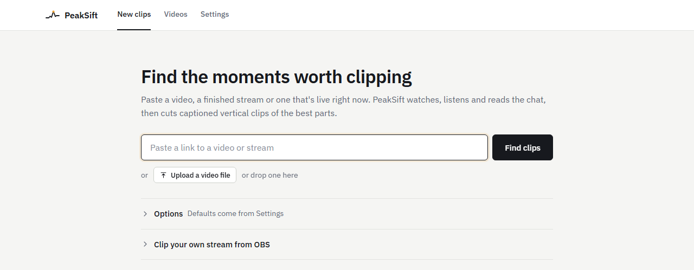

# PeakSift

**Turn long videos and live streams into ready-to-post vertical clips, on your own PC.**

[](https://github.com/aashutosh004/peaksift/actions/workflows/ci.yml)
[](LICENSE)
[](https://www.python.org/)

Paste a link (YouTube, Twitch, Kick, TikTok, Instagram, Facebook) or drop a video
file. PeakSift sifts through it for the moments worth clipping and exports
captioned 9:16 clips, ranked best first, each with the reason it was picked.

It works on a 30-second short, a 5-hour VOD (best moments of every hour) and a
stream that is **live right now**, including one you join hours in.

<!-- Screenshots: docs/images/ -->


## What makes it different

- **Finds moments from more than the transcript.** Audio intensity, shouting
  and exclamations, faces and facial reactions, motion, gameplay scene changes,
  live chat (spikes, laughter, hype, subs and donations), YouTube's
  "most replayed" curve and timestamps viewers left in the comments. Each is
  compared with what's normal *for that stream*, so a loud streamer doesn't
  flood the results. An optional AI judge re-ranks the shortlist and writes
  titles.
- **Live streams.** YouTube, Twitch and Kick, plus your own stream straight from
  OBS. Clips appear a minute or two behind live; press a key (or a button) to
  clip the last 30 seconds instantly.
- **Gaming layouts that follow the facecam.** Facecam on top, gameplay below —
  wherever the streamer moves the cam, the full scene when it's off, a
  close-up when they go full-screen. Draw the boxes yourself once per channel if
  you prefer.
- **Hindi and Hinglish.** Hindi speech gets Hinglish captions ("kya scene hai
  bhai") from Hinglish-trained models — 78% readable words against 46% for
  stock Whisper in our tests — or Devanagari if you choose.
- **Caption editor.** Fix any word, nudge timings, replace a misheard name in
  every clip at once, download .srt / .vtt.
- **Private and free.** Everything runs locally (NVIDIA GPU optional). No
  account, no upload, no watermark, no subscription. Cloud AI is opt-in.
- **Contained.** Everything it installs or downloads lives inside its folder.
  Delete the folder and it's gone.

## Quick start

You need **Python 3.11 or 3.12** ([download](https://www.python.org/downloads/);
on Windows tick *"Add python.exe to PATH"*) and **Git** (or download the ZIP from
the green *Code* button).

### Windows

```powershell
git clone https://github.com/aashutosh004/peaksift.git
```

Then open the `peaksift` folder and double-click **`Setup-PeakSift.cmd`**. It
installs everything into the folder (including ffmpeg) and checks your machine.
When it's done, double-click **`Start-PeakSift.cmd`** — the app opens in your
browser.

### macOS / Linux

```bash
git clone https://github.com/aashutosh004/peaksift.git
```

```bash
cd peaksift && ./setup.sh
```

```bash
./start.sh
```

On macOS install ffmpeg first with `brew install ffmpeg-full` (the plain `ffmpeg`
formula can't burn captions); on Ubuntu/Debian, `sudo apt install ffmpeg`. Full
details: [Getting started](docs/GETTING_STARTED.md).

## Two ways to use it

### The web app

`Start-PeakSift.cmd` (Windows) or `./start.sh` opens **http://localhost:8000**:

1. **New clips** — paste a link or upload a file, open *Options* if you like
   (type of video, best overall / per hour / per chapter, layout, captions) and
   press **Find clips**. A link that's live right now starts a live session.
2. **The video's page** — progress, then a strip showing where the moments are
   across the whole video, and your clips with players and why each was picked.
   Download, **Edit captions**, re-render, or **Adjust layout**.
3. **Settings** — AI judge and keys, speech models, clip length, defaults.

Tour: [docs/WEB_APP.md](docs/WEB_APP.md).

### The command line

From the PeakSift folder (`.\peaksift` on Windows, `./peaksift.sh` on macOS/Linux):

```powershell
.\peaksift clip "https://www.youtube.com/watch?v=..."              # a finished video
.\peaksift clip "https://www.twitch.tv/videos/123" --per-hour 3    # 5-hour VOD: best 3 of every hour
.\peaksift clip "C:\Videos\stream.mp4" --layout gaming             # a file, facecam over gameplay
.\peaksift live "https://www.twitch.tv/somechannel"                # live now, plus what you missed
.\peaksift live obs --chat https://www.twitch.tv/you               # your own stream from OBS
.\peaksift snap 30                                                 # clip the last 30 s of that live session
```

Every option and command: [docs/CLI.md](docs/CLI.md).

## What you need

| | |
|---|---|
| **Python** | 3.11 or 3.12 (3.13 isn't supported yet: MediaPipe has no packages for it) |
| **ffmpeg** | Windows: downloaded by setup. macOS: `brew install ffmpeg-full`. Linux: `apt install ffmpeg` |
| **GPU** | Optional. An NVIDIA card makes transcription several times faster; CPU works |
| **Disk** | ~3 GB for packages and ffmpeg, plus 1–3 GB per speech model, plus your videos |
| **AI judge** | Optional: [Ollama](https://ollama.com) (free, local — e.g. `ollama pull qwen3.5:9b`) or your own Anthropic / OpenAI / Gemini key |

On an RTX 5060 laptop GPU, a 23-minute gameplay video became 10 finished clips
in about 15 minutes.

## Documentation

| | |
|---|---|
| [Getting started](docs/GETTING_STARTED.md) | Install on each OS, GPU, AI judge, updating, uninstalling |
| [Web app](docs/WEB_APP.md) | Every page and button |
| [Command line](docs/CLI.md) | Every command and option |
| [How moments are found](docs/HOW_IT_WORKS.md) | The signals, the ranking, per-hour and per-chapter views |
| [Live streams](docs/LIVE.md) | YouTube, Twitch, Kick, OBS, snapshots, backfill |
| [Layouts](docs/LAYOUTS.md) | Facecam + gameplay, the picker, channel presets, two-person split |
| [Captions](docs/CAPTIONS.md) | Styles, Hindi/Hinglish models, Gemini, the editor, subtitle files |
| [Configuration](docs/CONFIGURATION.md) | Every setting in `config.json`, where files live |
| [Troubleshooting](docs/TROUBLESHOOTING.md) | Fixes for every problem we've hit |
| [Architecture](docs/ARCHITECTURE.md) · [Contributing](docs/CONTRIBUTING.md) | For developers |

## Privacy

Nothing leaves your PC unless you choose a cloud option:

- With a hosted AI judge (Anthropic, OpenAI, Gemini), the **transcript text** of
  candidate moments is sent to rank them and write titles — never video.
- With caption words from **Gemini**, the **audio of the exported clips** (only
  those seconds) is sent to Gemini to transcribe.
- Downloading from a link talks to that platform, as your browser would.

API keys are stored in `.local/data/config.json` inside the folder.

## Responsible use

Only clip videos you own or have permission to use, and follow each platform's
terms. PeakSift downloads only what you could watch yourself and contains no
way around DRM or paywalls, and never will.

## Credits

PeakSift builds on Whisper, faster-whisper, the Oriserve and Trelis Hinglish
models, OpenCV, MediaPipe, FFmpeg, yt-dlp and more — see [NOTICE.md](NOTICE.md).

## License

[MIT](LICENSE). Bundled fonts (Anton, Inter, IBM Plex Sans) are under the SIL Open Font License.
